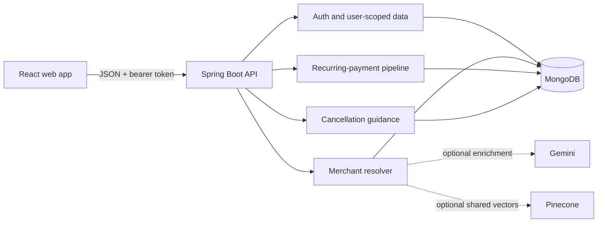

# MandateShield

**Find recurring payments hiding in transaction data, understand what they cost, and take informed action before the next charge.**

MandateShield is a hackathon-ready subscription and recurring-payment review app. It turns noisy bank descriptors into merchant identities, groups repeat charges, highlights trials and renewals, and gives people a clear cancellation workflow. The demo can be evaluated with a deterministic synthetic dataset without sharing real banking data.

> **Demo boundary:** MandateShield analyzes transactions supplied by the user or synthetic demo data. It does not connect to banks, move money, or cancel a mandate on the user's behalf. Cancellation requests in the app are tracking and guidance; users must confirm with their bank or merchant.

## What a judge can try

- **Descriptor resolution:** map strings such as `SPOTIFY INDIA MUMBAI` to a canonical merchant, category, payment rail, confidence, and resolution tier.
- **Recurring-payment review:** group transaction history and surface recurring payments, upcoming or annual renewals, trial conversion, price changes, resumed billing, and user-reported unused services.
- **Dashboard:** see recurring-payment and spend summaries with review signals.
- **Cancellation guidance:** view rail-specific playbooks, generate a bank/merchant notice, and track requested or confirmed cancellation states.
- **Synthetic evaluation:** seed and score a known dataset with expected merchant labels and billing scenarios.
- **Optional enrichment:** Gemini and Pinecone integrations can enrich merchant knowledge when configured. Core demo flows work without either integration.

## Architecture



**Stack:** React 19, Vite, Java 25, Spring Boot 4, Spring Security/JWT, MongoDB, Spring AI (optional), and Pinecone (optional).

## Run locally

### Prerequisites

- Java 25 (the backend Maven configuration targets Java 25)
- Node.js compatible with the Vite version in `frontend/package-lock.json`, plus npm
- A MongoDB database and connection URI
- PowerShell on Windows, or a POSIX-compatible shell on macOS/Linux

### Configure backend

From the repository root, copy `.env.example` to `.env` and edit the local copy. `.env` is ignored by Git.

Generate a fresh JWT signing key (Node.js):

```powershell
node -e "console.log(require('node:crypto').randomBytes(48).toString('base64url'))"
```

Paste the output into `MANDATESHIELD_JWT_SECRET` in `.env`. Set `MONGODB_URI` to your database connection string. Use a dedicated demo database and synthetic data for judging.

Gemini and Pinecone are optional. To enable Gemini enrichment, set `GOOGLE_GENAI_API_KEY` and `MANDATESHIELD_CHAT_MODEL=google-genai`. To enable Pinecone, set its API key and index details. Do not commit `.env`, real credentials, database dumps, or logs.

Start the backend from the repository root:

```powershell
./mvnw.cmd spring-boot:run
```

On macOS/Linux:

```bash
./mvnw spring-boot:run
```

The API listens on `http://localhost:8080`. Health is available at `GET /actuator/health`; interactive API docs are at `http://localhost:8080/swagger-ui.html`.

### Configure frontend

In a second terminal:

```powershell
cd frontend
npm ci
npm run dev
```

Open the Vite URL printed in the terminal (normally `http://localhost:5173`). The Vite development server proxies API requests to port 8080.

### First-run demo walkthrough

1. Register a fresh account in the app using a demo-only email and password.
2. Open the synthetic demo/evaluation flow and seed its known transaction patterns.
3. Review the dashboard and recurring-payment list; inspect trial conversion, price change, annual renewal, resumed billing, and unused-service signals.
4. Try a raw descriptor in Merchant Resolver, then compare the canonical result and confidence tier.
5. Open Cancellation Studio, review the payment-rail playbook, generate a sample notice, and mark a demo item requested or confirmed.
6. Open API docs to inspect the authenticated endpoints and use the examples below.

The seed endpoint may replace or add synthetic transactions for the signed-in user. Use a new demo account to keep judging runs isolated.

## API guide

Base URL: `http://localhost:8080`. All request and response bodies are JSON. Except registration, login, health, and API docs, endpoints require `Authorization: Bearer <token>`. Tokens are returned by register/login and expire after 24 hours by default.

### Register and authenticate

`POST /api/v1/auth/register` (201):

```json
{
  "fullName": "Demo Judge",
  "email": "judge@example.test",
  "password": "demo-password-123"
}
```

Example response (token abbreviated):

```json
{
  "token": "eyJ...<abbreviated>...Q",
  "user": { "id": 1042, "name": "Demo Judge", "email": "judge@example.test" }
}
```

`POST /api/v1/auth/login` accepts `{ "email": "judge@example.test", "password": "demo-password-123" }` and returns the same session shape. `GET /api/v1/auth/me` returns the current user. Keep real tokens private; the values above are illustrative only.

### Resolve a merchant descriptor

`POST /api/v1/resolver/resolve` (authenticated):

```json
{
  "rawDescriptor": "SPOTIFY INDIA MUMBAI",
  "amount": 119.00,
  "currency": "INR",
  "transactionDate": "2026-10-01T00:00:00Z"
}
```

Example response (the exact match depends on configured merchant patterns):

```json
{
  "brandName": "Spotify",
  "category": "Entertainment",
  "gateway": "UPI",
  "confidenceScore": 0.96,
  "resolutionTier": "TIER_1",
  "matchedPattern": "..."
}
```

The descriptor is required; amount, currency, and date are optional resolver context. `GET /api/v1/resolver/patterns` lists patterns visible to the resolver; `POST /api/v1/resolver/patterns/cache/clear` clears the compiled-pattern cache.

### Add and list transactions

`POST /api/v1/transactions` (201):

```json
{
  "rawDescriptor": "SPOTIFY INDIA MUMBAI",
  "amount": 119.00,
  "currency": "INR",
  "category": "Entertainment",
  "paymentRail": "UPI",
  "transactionDate": "2026-10-01"
}
```

Accepted descriptor aliases include `merchant`, `raw_descriptor`, and `rawDescriptor`; date aliases include `date`, `transaction_date`, and `transactionDate`. A supplied `merchantName` can be used as a confirmed label. A free trial can be marked with `trialTransaction: true`, with optional `trialEndDate` and `trialConversionAmount`.

Example response:

```json
{
  "id": "6712abc12345678901234567",
  "merchant": "Spotify",
  "rawDescriptor": "SPOTIFY INDIA MUMBAI",
  "amount": 119.00,
  "currency": "INR",
  "category": "Entertainment",
  "paymentRail": "UPI",
  "date": "2026-10-01",
  "confidenceScore": 0.96,
  "resolutionTier": "TIER_1"
}
```

`GET /api/v1/transactions` returns the signed-in user's transactions. `POST /api/v1/transactions/import` accepts an array of 1–500 transaction objects. `DELETE /api/v1/transactions/{id}` deletes only a transaction owned by the current user and returns 204.

### Dashboard and processing

- `GET /api/v1/dashboard` returns dashboard KPIs for the signed-in user. Its fields are represented by `DashboardKpiResponse` in the API docs.
- `POST /api/v1/pipeline/run` processes the signed-in user's transaction history and returns a pipeline run summary.
- `POST /api/v1/demo/seed` seeds/evaluates synthetic scenarios for the signed-in user and returns an evaluation report.
- `GET /api/v1/demo/evaluation` evaluates the current user's available demo dataset.

The exact counts depend on the user's current data. On an untouched synthetic run, expected evaluation outcomes include all seeded merchant labels matching, recurring groups detected, and the planted billing scenarios flagged. The endpoint response is the source of truth for counts and pass/fail fields.

### Cancellation guidance and state tracking

`GET /api/v1/cancellation/playbook?rail=UPI&merchant=Spotify` returns guidance for a payment rail and optional merchant.

`POST /api/v1/cancellation/generate-letter`:

```json
{
  "merchantName": "Spotify",
  "bankName": "Example Bank",
  "mandateRef": "DEMO-MANDATE-001"
}
```

Use `subscriptionId` instead of `merchantName` to derive the merchant from one of the user's recurring payments. Example response:

```json
{
  "letter": "To: Example Bank\nSubject: Request to revoke mandate DEMO-MANDATE-001 ..."
}
```

For an existing recurring-payment ID, these authenticated routes update the user's tracking state: `POST /api/v1/cancellation/{subscriptionId}/request`, `/confirm`, `/revoke`, `/report-unused`, and `/confirm-activity`. The request/revoke actions record that the user requested cancellation; they do not contact the bank or merchant. Confirm only after verifying cancellation with the provider.

### Status codes and errors

Typical responses: `200` success, `201` created, `204` deleted, `400` invalid request, `401` missing/invalid credentials or incorrect login, `403` authenticated but forbidden, `404` resource not found or not owned by the user, and `409` duplicate registration email. Error bodies follow Spring's Problem Detail format and may include a `detail` message.

## Security and configuration

- Secrets are loaded from environment variables or the ignored local `.env`; `.env.example` contains placeholders only.
- The JWT key has **no source-code fallback**. Backend startup requires `MANDATESHIELD_JWT_SECRET`; use a unique random secret of at least 32 bytes.
- Passwords are stored as password hashes. Authenticated transaction and cancellation lookups are scoped to the signed-in user.
- Gemini, Pinecone, and MongoDB credentials must be provided by the deployer. Keep them out of source, screenshots, issue reports, and demo JSON.
- If a credential was ever committed or shared, revoke/rotate it at its provider before publishing. Removing it from a working tree does not erase Git history.
- For a public deployment, configure HTTPS, a production MongoDB account with least privilege, a restricted database network policy, and an explicit allowed frontend origin in CORS.

## Tests and GitHub checks

Run the backend tests from the repository root:

```powershell
./mvnw.cmd test
```

Run frontend static checks and production build:

```powershell
cd frontend
npm ci
npm run lint
npm run build
```

The GitHub Actions workflow runs the backend test suite and frontend lint/build on pushes and pull requests. Live API checks require MongoDB and valid local configuration; use a dedicated test database and synthetic account. Never use production credentials or personal banking records for a judging run.

## Repository layout

```text
src/main/java/com/mandateshield/   Spring Boot API, domain, services, pipeline
src/main/resources/                Application configuration
src/test/java/                     Backend tests
frontend/src/                      React application
.env.example                       Safe configuration template
.github/workflows/ci.yml            GitHub Actions checks
```

## License

No license is declared yet. Add the license you intend before inviting reuse or accepting outside contributions.
